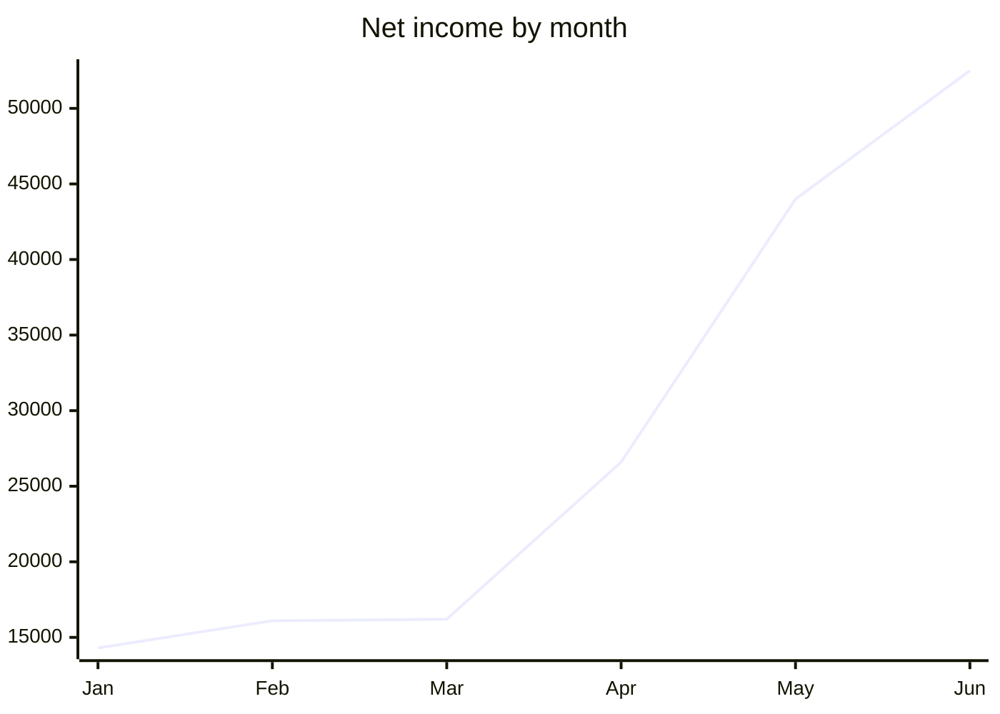

## Budget

### Harbour budget, first half

Amounts in euros; the totals are formulas.

| Category | Jan | Feb | Mar | Apr | May | Jun | Total | Share |
| --- | --- | --- | --- | --- | --- | --- | --- | --- |
| Berths let | €11,200 | €11,800 | €12,100 | €15,400 | €21,800 | €24,900 | €97,200 | 57.3% |
| Visitors | €3,100 | €3,300 | €4,800 | €8,200 | €15,600 | €19,200 | €54,200 | 31.9% |
| Shop | €1,200 | €1,100 | €1,500 | €2,600 | €4,100 | €5,200 | €15,700 | 9.3% |
| Fuel | €900 | €800 | €1,100 | €1,900 | €3,300 | €4,400 | €12,400 | 7.3% |
| Repairs | -€2,100 | -€900 | -€3,300 | -€1,500 | -€800 | -€1,200 | -€9,800 | -5.8% |
| Net | €14,300 | €16,100 | €16,200 | €26,600 | €44,000 | €52,500 | €169,700 | 100.0% |
|  |  |  |  |  |  |  |  |  |
| Averages and checks |  |  |  |  |  |  |  |  |
| Average a month | €28,283 | Best month | Jun | Months in credit | 6 |  |  |  |
| Largest item | €24,900 | Rounded share of fuel | 7.3% | Status | surplus |  |  |  |
| Lookup: category | Shop | its total | €15,700 |  |  |  |  |  |
| Link | exav.org/viewer | Note on a cell | hover me |  |  |  |  |  |

## Data

| Date | Region | Product | Units | Unit price | Amount |
| --- | --- | --- | --- | --- | --- |
| 2000-01-01 | West | Mooring | 32 | €15.74 | €503.68 |
| 2000-01-02 | East | Power | 4 | €48.47 | €193.88 |
| 2000-01-03 | North | Fuel | 34 | €7.46 | €253.64 |
| 2000-01-04 | South | Shop | 23 | €27.12 | €623.76 |
| 2000-01-06 | West | Water | 25 | €11.26 | €281.50 |
| 2000-01-07 | East | Mooring | 19 | €44.61 | €847.59 |
| 2000-01-08 | North | Power | 2 | €24.69 | €49.38 |
| 2000-01-09 | South | Fuel | 5 | €31.97 | €159.85 |
| 2000-01-11 | West | Shop | 17 | €36.03 | €612.51 |
| 2000-01-12 | East | Water | 17 | €44.79 | €761.43 |
| 2000-01-13 | North | Mooring | 30 | €18.48 | €554.40 |
| 2000-01-14 | South | Power | 38 | €39.62 | €1,505.56 |
| 2000-01-16 | West | Fuel | 26 | €18.98 | €493.48 |
| 2000-01-17 | East | Shop | 28 | €2.09 | €58.52 |
| 2000-01-18 | North | Water | 3 | €19.31 | €57.93 |
| 2000-01-19 | South | Mooring | 38 | €20.21 | €767.98 |
| 2000-01-21 | West | Power | 2 | €35.94 | €71.88 |
| 2000-01-22 | East | Fuel | 35 | €29.34 | €1,026.90 |
| 2000-01-23 | North | Shop | 8 | €3.76 | €30.08 |
| 2000-01-24 | South | Water | 31 | €43.00 | €1,333.00 |
| 2000-01-26 | West | Mooring | 21 | €7.27 | €152.67 |
| 2000-01-27 | East | Power | 15 | €40.31 | €604.65 |
| 2000-01-28 | North | Fuel | 21 | €14.02 | €294.42 |
| 2000-02-01 | South | Shop | 37 | €38.55 | €1,426.35 |
| 2000-02-03 | West | Water | 10 | €45.02 | €450.20 |
| 2000-02-04 | East | Mooring | 12 | €43.89 | €526.68 |
| 2000-02-05 | North | Power | 26 | €50.13 | €1,303.38 |
| 2000-02-06 | South | Fuel | 9 | €40.14 | €361.26 |
| 2000-02-08 | West | Shop | 1 | €49.56 | €49.56 |
| 2000-02-09 | East | Water | 27 | €26.86 | €725.22 |
| 2000-02-10 | North | Mooring | 38 | €52.95 | €2,012.10 |
| 2000-02-11 | South | Power | 30 | €7.93 | €237.90 |
| 2000-02-13 | West | Fuel | 24 | €24.85 | €596.40 |
| 2000-02-14 | East | Shop | 34 | €29.82 | €1,013.88 |
| 2000-02-15 | North | Water | 16 | €42.51 | €680.16 |
| 2000-02-16 | South | Mooring | 6 | €18.93 | €113.58 |
| 2000-02-18 | West | Power | 25 | €17.97 | €449.25 |
| 2000-02-19 | East | Fuel | 34 | €34.58 | €1,175.72 |
| 2000-02-20 | North | Shop | 16 | €37.55 | €600.80 |
| 2000-02-21 | South | Water | 16 | €13.41 | €214.56 |
| 2000-02-23 | West | Mooring | 32 | €45.32 | €1,450.24 |
| 2000-02-24 | East | Power | 8 | €45.63 | €365.04 |
| 2000-02-25 | North | Fuel | 13 | €55.42 | €720.46 |
| 2000-02-26 | South | Shop | 23 | €13.93 | €320.39 |
| 2000-02-28 | West | Water | 10 | €11.80 | €118.00 |
| 2000-03-01 | East | Mooring | 34 | €57.93 | €1,969.62 |
| 2000-03-02 | North | Power | 38 | €37.20 | €1,413.60 |
| 2000-03-03 | South | Fuel | 25 | €58.29 | €1,457.25 |
| 2000-03-05 | West | Shop | 24 | €47.82 | €1,147.68 |
| 2000-03-06 | East | Water | 31 | €5.14 | €159.34 |
| 2000-03-07 | North | Mooring | 21 | €6.92 | €145.32 |
| 2000-03-08 | South | Power | 15 | €13.22 | €198.30 |
| 2000-03-10 | West | Fuel | 28 | €51.80 | €1,450.40 |
| 2000-03-11 | East | Shop | 9 | €9.35 | €84.15 |
| 2000-03-12 | North | Water | 3 | €30.59 | €91.77 |
| 2000-03-13 | South | Mooring | 12 | €51.27 | €615.24 |
| 2000-03-15 | West | Power | 23 | €43.07 | €990.61 |
| 2000-03-16 | East | Fuel | 38 | €14.39 | €546.82 |
| 2000-03-17 | North | Shop | 30 | €42.95 | €1,288.50 |
| 2000-03-18 | South | Water | 22 | €5.01 | €110.22 |
| 2000-03-20 | West | Mooring | 12 | €23.36 | €280.32 |
| 2000-03-21 | East | Power | 27 | €36.20 | €977.40 |
| 2000-03-22 | North | Fuel | 4 | €40.81 | €163.24 |
| 2000-03-23 | South | Shop | 27 | €32.34 | €873.18 |
| 2000-03-25 | West | Water | 12 | €13.49 | €161.88 |
| 2000-03-26 | East | Mooring | 22 | €30.72 | €675.84 |
| 2000-03-27 | North | Power | 25 | €29.88 | €747.00 |
| 2000-03-28 | South | Fuel | 5 | €33.10 | €165.50 |
| 2000-04-02 | West | Shop | 29 | €24.83 | €720.07 |
| 2000-04-03 | East | Water | 31 | €3.14 | €97.34 |
| 2000-04-04 | North | Mooring | 25 | €13.90 | €347.50 |
| 2000-04-05 | South | Power | 21 | €44.99 | €944.79 |
| 2000-04-07 | West | Fuel | 27 | €24.07 | €649.89 |
| 2000-04-08 | East | Shop | 16 | €54.75 | €876.00 |
| 2000-04-09 | North | Water | 4 | €22.23 | €88.92 |
| 2000-04-10 | South | Mooring | 16 | €22.19 | €355.04 |
| 2000-04-12 | West | Power | 20 | €7.41 | €148.20 |
| 2000-04-13 | East | Fuel | 19 | €33.71 | €640.49 |
| 2000-04-14 | North | Shop | 3 | €34.65 | €103.95 |
| 2000-04-15 | South | Water | 36 | €45.15 | €1,625.40 |
| 2000-04-17 | West | Mooring | 1 | €50.84 | €50.84 |
| 2000-04-18 | East | Power | 37 | €45.15 | €1,670.55 |
| 2000-04-19 | North | Fuel | 6 | €49.57 | €297.42 |
| 2000-04-20 | South | Shop | 32 | €16.72 | €535.04 |
| 2000-04-22 | West | Water | 22 | €21.88 | €481.36 |
| 2000-04-23 | East | Mooring | 19 | €17.18 | €326.42 |
| 2000-04-24 | North | Power | 20 | €20.44 | €408.80 |
| 2000-04-25 | South | Fuel | 23 | €37.88 | €871.24 |
| 2000-04-27 | West | Shop | 7 | €8.06 | €56.42 |
| 2000-04-28 | East | Water | 23 | €27.66 | €636.18 |
| 2000-05-01 | North | Mooring | 37 | €42.99 | €1,590.63 |
| 2000-05-02 | South | Power | 16 | €7.11 | €113.76 |
| 2000-05-04 | West | Fuel | 5 | €31.73 | €158.65 |
| 2000-05-05 | East | Shop | 7 | €25.47 | €178.29 |
| 2000-05-06 | North | Water | 35 | €21.31 | €745.85 |
| 2000-05-07 | South | Mooring | 26 | €13.44 | €349.44 |
| 2000-05-09 | West | Power | 34 | €16.15 | €549.10 |
| 2000-05-10 | East | Fuel | 37 | €10.53 | €389.61 |
| 2000-05-11 | North | Shop | 6 | €21.70 | €130.20 |
| 2000-05-12 | South | Water | 11 | €15.06 | €165.66 |
| 2000-05-14 | West | Mooring | 25 | €56.34 | €1,408.50 |
| 2000-05-15 | East | Power | 21 | €9.31 | €195.51 |
| 2000-05-16 | North | Fuel | 31 | €40.75 | €1,263.25 |
| 2000-05-17 | South | Shop | 17 | €53.31 | €906.27 |
| 2000-05-19 | West | Water | 37 | €10.33 | €382.21 |
| 2000-05-20 | East | Mooring | 39 | €33.16 | €1,293.24 |
| 2000-05-21 | North | Power | 4 | €5.08 | €20.32 |
| 2000-05-22 | South | Fuel | 35 | €36.12 | €1,264.20 |
| 2000-05-24 | West | Shop | 2 | €46.53 | €93.06 |
| 2000-05-25 | East | Water | 7 | €56.38 | €394.66 |
| 2000-05-26 | North | Mooring | 12 | €2.52 | €30.24 |
| 2000-05-27 | South | Power | 21 | €5.73 | €120.33 |
| 2000-06-01 | West | Fuel | 5 | €51.14 | €255.70 |
| 2000-06-02 | East | Shop | 17 | €15.73 | €267.41 |
| 2000-06-03 | North | Water | 5 | €25.51 | €127.55 |
| 2000-06-04 | South | Mooring | 27 | €17.38 | €469.26 |
| 2000-06-06 | West | Power | 39 | €19.88 | €775.32 |
| 2000-06-07 | East | Fuel | 28 | €23.57 | €659.96 |
| 2000-06-08 | North | Shop | 18 | €30.72 | €552.96 |
| 2000-06-09 | South | Water | 30 | €47.47 | €1,424.10 |
| Total |  |  | €2,479 |  | €70,070 |

## Charts

### Spending by category

**Jan**

| Category | Value | Display value |
| --- | --- | --- |
| Berths let | 11200 | €11,200 |
| Visitors | 3100 | €3,100 |
| Shop | 1200 | €1,200 |
| Fuel | 900 | €900 |

**Jun**

| Category | Value | Display value |
| --- | --- | --- |
| Berths let | 24900 | €24,900 |
| Visitors | 19200 | €19,200 |
| Shop | 5200 | €5,200 |
| Fuel | 4400 | €4,400 |

### Share of the total

**Share**

| Point | Value | Display value |
| --- | --- | --- |
| 1 | 0.572775486152033 | 57.3% |
| 2 | 0.319387153800825 | 31.9% |
| 3 | 0.0925162050677666 | 9.3% |
| 4 | 0.0730701237477902 | 7.3% |
| 5 | -0.0577489687684149 | -5.8% |
